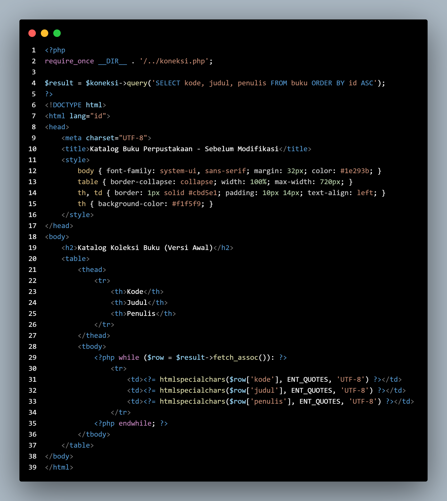
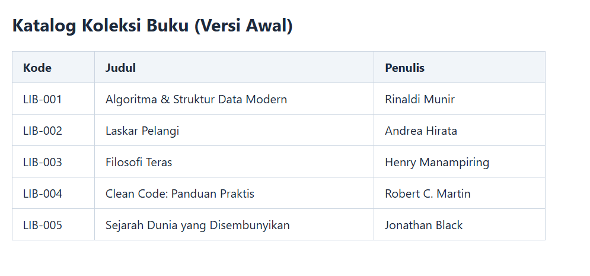
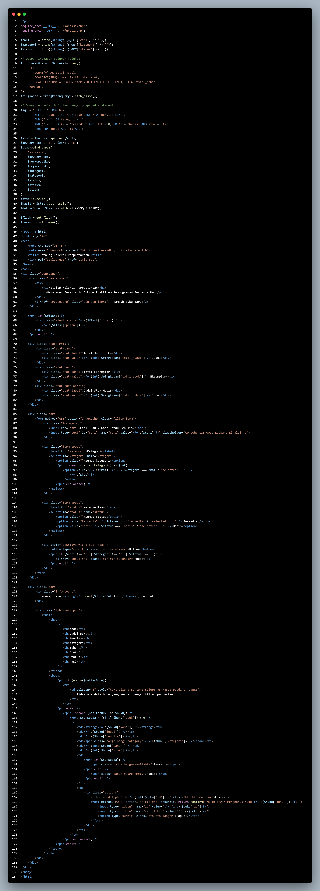
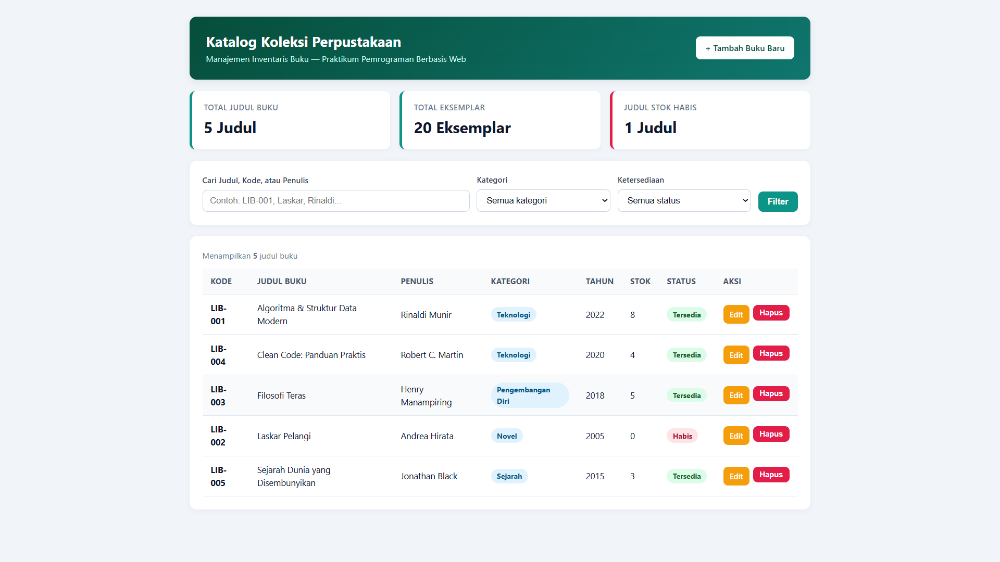

# Tugas 5 - Integrasi PHP MySQL dan CRUD Katalog Perpustakaan

## 1. Modifikasi Program

Praktikum ini menerapkan koneksi PHP–MySQL menggunakan ekstensi **MySQLi** dengan studi kasus **Katalog Koleksi Perpustakaan**. Materi referensi awal menggunakan studi kasus data mahasiswa; pada tugas ini struktur database dan alur aplikasi diadaptasi menjadi sistem pengelolaan koleksi buku dengan database terpisah bernama `db_perpus_pbw`.

Versi dasar pada `sebelum/index.php` mengadaptasi alur `SELECT` dan perulangan `fetch_assoc()` untuk menampilkan kode, judul, dan penulis buku dalam tabel sederhana sebagai pembanding awal sebelum modifikasi dilakukan.

Modifikasi yang diterapkan pada versi akhir meliputi:

1. **Kelengkapan atribut koleksi:** menambahkan kolom `kategori`, `tahun` terbit, dan `stok`. Status ketersediaan diturunkan secara otomatis dari jumlah stok (`stok > 0` berstatus **Tersedia**, sedangkan `stok = 0` berstatus **Habis**).
2. **Pencarian dan filter multi-kriteria:** fitur pencarian kata kunci berdasarkan judul, kode, atau penulis yang dapat dikombinasikan secara bersamaan dengan filter kategori dan filter status ketersediaan, lalu diurutkan berdasarkan judul buku (`ORDER BY judul ASC, id ASC`).
3. **Pengelolaan data (CRUD) aman:** menyediakan halaman tambah buku (`create.php` dan `store.php`), ubah data (`edit.php` dan `update.php`), serta penghapusan data via metode `POST` dengan konfirmasi dialog dan validasi token sesi CSRF (`delete.php`).
4. **Validasi sisi server dan penanganan duplikat:** memastikan kode buku bersifat unik (`UNIQUE`), tahun terbit berada pada rentang 1900 hingga tahun berjalan, serta stok berupa bilangan bulat 0–999. Apabila terjadi kesalahan input atau duplikasi kode, pesan error ditampilkan tanpa menghapus isian formulir sebelumnya.
5. **Tampilan dan ringkasan statistik:** menampilkan kartu ringkasan total judul buku, total eksemplar stok, dan jumlah judul yang stoknya habis, didukung file CSS lokal (`style.css`) tanpa ketergantungan pada CDN eksternal.

---

## 2. Penjelasan 5 Bagian Kode Paling Penting

### 1. Koneksi Database — `koneksi.php`

```php
mysqli_report(MYSQLI_REPORT_ERROR | MYSQLI_REPORT_STRICT);

$koneksi = new mysqli(
    getenv('PBW_DB_HOST') ?: '127.0.0.1',
    getenv('PBW_DB_USER') ?: 'root',
    getenv('PBW_DB_PASSWORD') ?: '',
    getenv('PBW_DB_NAME') ?: 'db_perpus_pbw',
    (int) (getenv('PBW_DB_PORT') ?: 3306)
);
$koneksi->set_charset('utf8mb4');
```

Konfigurasi ini menghubungkan aplikasi PHP dengan server MySQL menggunakan `utf8mb4` agar seluruh karakter Unicode tersimpan dengan baik. Mode pelaporan `MYSQLI_REPORT_STRICT` memungkinkan kesalahan koneksi maupun query ditangkap secara terstruktur melalui blok `try-catch`.

### 2. Pencarian dan Filter — `index.php`

```sql
SELECT * FROM buku
WHERE (judul LIKE ? OR kode LIKE ? OR penulis LIKE ?)
AND (? = '' OR kategori = ?)
AND (? = '' OR (? = 'tersedia' AND stok > 0) OR (? = 'habis' AND stok = 0))
ORDER BY judul ASC, id ASC
```

Operator `LIKE` mencari kecocokan kata kunci pada kolom judul, kode, dan penulis secara bersamaan. Parameter kategori dan status ketersediaan hanya menyaring baris apabila pengguna memilih nilai filter tertentu. Seluruh input pengguna diikat melalui `bind_param()` sehingga diperlakukan sebagai data murni dan aman dari celah SQL Injection.

### 3. Penambahan dan Pembaruan Data — `store.php` dan `update.php`

```sql
INSERT INTO buku (kode, judul, penulis, kategori, tahun, stok)
VALUES (?, ?, ?, ?, ?, ?)

UPDATE buku SET kode = ?, judul = ?, penulis = ?, kategori = ?, tahun = ?, stok = ?
WHERE id = ?
```

Query `INSERT` digunakan untuk menambahkan entri buku baru ke tabel `buku`, sedangkan `UPDATE` memperbarui baris data yang dibatasi oleh klausa `WHERE id = ?` agar perubahan tidak memengaruhi seluruh koleksi. Setelah eksekusi berhasil, aplikasi melakukan redirect HTTP `303` ke `index.php` guna mencegah pengiriman ulang formulir saat halaman dimuat ulang.

### 4. Validasi Input dan Penanganan Kode Duplikat — `fungsi.php` dan `store.php`

```php
if (filter_var($data['stok'], FILTER_VALIDATE_INT, [
    'options' => ['min_range' => 0, 'max_range' => 999],
]) === false) {
    $errors[] = 'Stok harus bilangan bulat 0–999.';
}

if ($error->getCode() === 1062) {
    $errors[] = 'Kode buku sudah digunakan. Gunakan kode lain.';
}
```

Validasi di sisi server tetap menjaga integritas data meskipun validasi HTML pada browser dilewati. Constraint `UNIQUE` pada kolom `kode` mencegah penyimpanan kode ganda di tingkat database, dan kode eksepsi MySQL `1062` diterjemahkan menjadi pesan kesalahan informatif dengan status respons HTTP `422` sambil mempertahankan nilai input sebelumnya pada formulir.

### 5. Sanitasi Tampilan dan Penghapusan Data — `fungsi.php` dan `delete.php`

```php
function e(?string $nilai): string
{
    return htmlspecialchars((string) $nilai, ENT_QUOTES, 'UTF-8');
}

$stmt = $koneksi->prepare('DELETE FROM buku WHERE id = ?');
$stmt->bind_param('i', $id);
$stmt->execute();
```

Setiap nilai dari database maupun input pengguna dibersihkan menggunakan fungsi pembantu `e()` berbasis `htmlspecialchars()` sebelum dirender ke HTML untuk mencegah serangan XSS. Proses penghapusan mewajibkan metode `POST` dan kecocokan token CSRF sesi, kemudian memeriksa `affected_rows` untuk memastikan baris data benar-benar terhapus.

---

## 3. Screenshot Sebelum dan Sesudah Modifikasi

### Kode Sebelum Modifikasi

Versi awal pada `sebelum/index.php` menjalankan query `SELECT kode, judul, penulis FROM buku ORDER BY id ASC` dan menampilkan hasilnya ke dalam tabel tiga kolom menggunakan perulangan `while` dan `htmlspecialchars()`.



### Tampilan Sebelum Modifikasi

Tampilan awal berisi lima koleksi buku (`LIB-001` hingga `LIB-005`) dengan kolom kode, judul, dan penulis tanpa fitur pencarian, filter kategori, ringkasan statistik, maupun tombol aksi CRUD.



### Kode Sesudah Modifikasi

File `index.php` utama menambahkan query ringkasan agregat (`COUNT` dan `SUM`), pembacaan parameter `GET` untuk pencarian dan filter, pengikatan parameter via `bind_param()`, serta tombol aksi Edit dan Hapus berbasis `POST`.



### Tampilan Sesudah Modifikasi

Halaman utama menampilkan kartu ringkasan **5 Judul**, **20 Eksemplar**, dan **1 Judul Stok Habis**, dilengkapi tombol tambah buku, formulir pencarian dan filter, serta tabel koleksi dengan status **Tersedia** dan **Habis**.



---

## 4. Error yang Muncul, Penyebab, dan Perbaikan

### 1. Kode Buku Duplikat (`MySQL Error 1062`)

- **Penyebab:** Saat menambahkan atau mengubah buku menggunakan kode yang sudah terdaftar pada database (misalnya `LIB-001`), penyimpanan ditolak oleh constraint `UNIQUE` pada kolom `kode` di tabel `buku` sehingga memicu eksepsi `mysqli_sql_exception` dengan kode error `1062` (*Duplicate entry*).
- **Perbaikan:** Blok `try-catch` pada `store.php` dan `update.php` menangkap kode error `1062`, menampilkan pesan peringatan **“Kode buku sudah digunakan. Gunakan kode lain.”** dengan status respons HTTP `422`, serta mempertahankan seluruh isian formulir agar pengguna cukup mengganti kode buku menjadi kode unik yang belum terpakai.

### 2. Validasi Batas Input dan Parameter URL

- **Penyebab:** Input tahun terbit di luar rentang 1900 hingga tahun berjalan, nilai stok negatif/di atas 999, atau akses halaman edit tanpa parameter `id` bilangan bulat yang valid berpotensi menimbulkan kesalahan penyimpanan data.
- **Perbaikan:** Ditambahkan fungsi `validasi_buku()` di sisi server menggunakan `filter_var(..., FILTER_VALIDATE_INT)` serta pengecekan ID dan token CSRF sesi sebelum query `UPDATE` maupun `DELETE` dieksekusi.